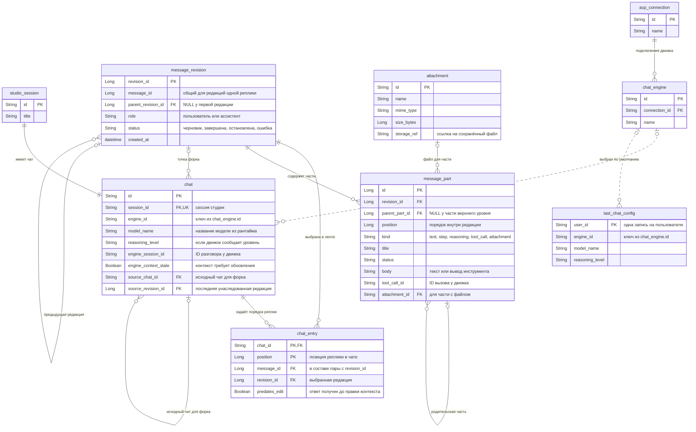

# AI Studio. История чата, редакции и форки

Это проект схемы локальной БД Heartbeat. Пользователь читает историю из БД, а движок продолжает разговор в своей сессии. Каждый форк открывается отдельным чатом. Исходный чат и форк могут показывать разные редакции одной реплики и совместно использовать сохранённые файлы.

## ER-диаграмма

Историю хранят пять таблиц — `chat`, `chat_entry`, `message_revision`, `message_part` и `attachment`. Таблица `last_chat_config` хранит выбор пользователя для следующего чата. У существующих таблиц `studio_session`, `chat_engine` и `acp_connection` показаны поля, участвующие в этих связях.

### Ключи и порядок

- **Типы.** Локальные ID реплик, редакций и частей, а также ссылки на них имеют тип `Long` в Kotlin и `INTEGER` в SQLite. Для одиночных первичных ключей редакции и части используется `INTEGER PRIMARY KEY`. Ключ настроенного движка `engine_id`, ID разговора `engine_session_id` и ID вызова `tool_call_id` сохраняются строками. Пунктир показывает поиск движка в каталоге по сохранённому ключу.
- **Позиция в чате.** Первичный ключ `chat_entry` — `(chat_id, position)`. Ограничение `UNIQUE(chat_id, message_id)` оставляет одну видимую редакцию реплики в каждом чате. Составной внешний ключ `(message_id, revision_id)` ссылается на уникальную пару тех же полей в `message_revision`.
- **Редакции и части.** У новой редакции сохраняется `message_id`, а `parent_revision_id` указывает на предыдущую редакцию этой реплики. Внутри редакции действует `UNIQUE(revision_id, position)`. Родительская и дочерняя части принадлежат одной редакции. Например, вызов инструмента может содержать дочернюю часть с файлом.

## Потоки данных

### Создание чата и первая отправка

1. Bootstrap читает `last_chat_config` и ищет выбранный движок в каталоге. Если записи ещё нет или движок удалён, пользователь выбирает доступный движок. До выбора создание сессии и первая отправка заблокированы. Текст и вложения остаются в черновике.
2. Bootstrap получает движок по его ключу и открывает сессию. Движок сообщает доступные модели и уровни рассуждения. Bootstrap подставляет прошлый выбор, если он доступен. Если прежняя модель исчезла, пользователь выбирает другую. Поле параметра, который движок не сообщает, остаётся пустым.
3. При подтверждении студия одной локальной транзакцией сохраняет сессию студии, чат, ключ разговора у движка, подтверждённые параметры и `last_chat_config`. Отмена черновика сохраняет прежний выбор по умолчанию.
4. Первую реплику студия сохраняет и отправляет тем же способом, что и последующие. Сбой отправки после создания чата позволяет повторить попытку в том же чате. Смена движка, модели и уровня в существующем чате отложена.

### Отправка сообщения с вложением

Для сообщения «Проверь лог» с файлом `build.log` студия сначала сохраняет файл в долговечном хранилище. Когда файл доступен, в БД фиксируются метаданные `attachment`, редакция пользовательской реплики, две упорядоченные части (текст и файл) и строка `chat_entry`. Экран уже может показать реплику, пока движок обрабатывает запрос.

Отправка движку происходит за пределами транзакции БД. Если связь оборвалась после отправки, студия сверяет результат с движком, когда это возможно. Неопределённый результат сам по себе не служит основанием для автоматической повторной отправки.

### Потоковый ответ, инструменты и завершение

В начале ответа студия создаёт одну черновую `message_revision` ассистента и помещает её в ленту. События движка обновляют эту редакцию.

| Событие | Изменение в БД |
| --- | --- |
| Фрагмент текста или размышления | Студия открывает часть нужного типа и дополняет её `body`. Интерфейс показывает фрагменты по мере получения, запись на диск выполняется порциями. |
| Начало шага или вызов инструмента | Создаётся `message_part` со своей позицией. Для вложенного события указывается `parent_part_id`. |
| Обновление инструмента | По сессии движка и `tool_call_id` студия находит вызов в текущем ответе и обновляет его статус и результат. Порядок параллельных вызовов сохраняется, даже если второй завершился первым. |
| Результат в виде файла | Студия сохраняет файл и его метаданные, затем привязывает к вызову дочернюю часть с `attachment_id`. |
| Завершение, отмена или ошибка | Студия записывает остаток буфера и фиксирует редакцию с итоговым статусом. Полученная часть прерванного ответа остаётся доступной. Последующие правки создают новую редакцию. |

### Чтение истории и продолжение разговора

При открытии чата студия читает страницу `chat_entry` по позиции, выбирает указанные в ней редакции и части. Для свёрнутого размышления или лога сначала достаточно заголовка и статуса. Полный текст читается при раскрытии, файл — при открытии вложения. Этот путь работает и при недоступном движке.

Для следующей отправки студия находит движок по `engine_id` и разговор по `engine_session_id`. При повторной загрузке истории уже сохранённые реплики сохраняют свои позиции и отображаются однократно. Если движок вернул укороченную историю или потерял сессию, локальная переписка остаётся доступной.

### Форк от выбранного сообщения

Форк создаётся от зафиксированной редакции **включительно**. В одной локальной транзакции студия проверяет принадлежность редакции исходной ленте, создаёт отдельную сессию студии и чат, сохраняет `source_chat_id` и `source_revision_id`, затем копирует строки `chat_entry` до выбранной позиции. Оба чата ссылаются на одни и те же редакции, части и файлы.

Форк наследует параметры движка исходного чата. Собственный `engine_session_id` появляется при подготовке разговора для продолжения. Движок получает контекст до выбранной редакции включительно.

### Редактирование и подготовка контекста

Пусть оба чата показывают сообщение с `message_id = 42` и `revision_id = 101`. Пользователь исправляет его в форке. Студия создаёт редакцию `108` с `message_id = 42` и `parent_revision_id = 101`. В строке `chat_entry` форка теперь хранится пара чисел `(42, 108)`, в исходном чате — `(42, 101)`. Вложения, общие для двух редакций, по-прежнему ссылаются на одну запись `attachment`.

| Выбор пользователя | Что происходит в изменённом чате |
| --- | --- |
| Сохранить продолжение | Позиции следующих реплик сохраняются. У зависимых ответов ассистента студия выставляет `chat_entry.predates_edit`, поскольку они были получены в прежнем контексте. |
| Отсечь продолжение | Студия удаляет ссылки после исправленной позиции из ленты этого чата. Другие чаты сохраняют свои ссылки. |

Выбор новой редакции, изменение продолжения и установка `chat.engine_context_stale` фиксируются одной транзакцией. Перед следующей отправкой студия подготавливает контекст по видимым редакциям. Флаг снимается после успешной подготовки. Сохранённый вывод инструментов передаётся как история, без повторного выполнения команд.

### Удаление чата

При удалении чата студия удаляет его `chat_entry`. В дочерних форках `source_chat_id` становится `NULL`, а `source_revision_id` и собственные ленты сохраняются. Редакцию и её части можно очистить после исчезновения всех ссылок из лент, точек форка и сохраняемых дочерних редакций. Файл можно удалить после исчезновения последней части, ссылающейся на его `attachment_id`.
