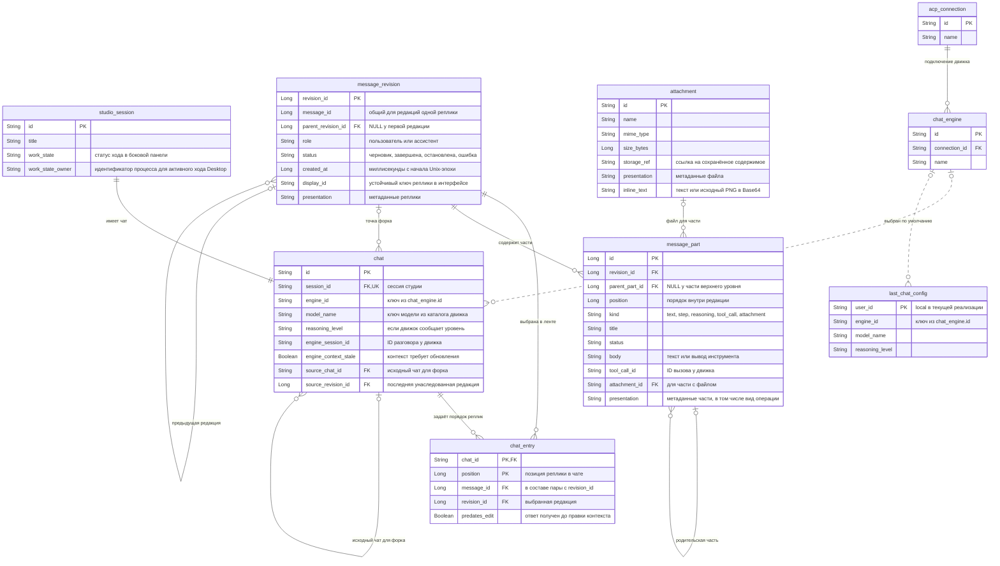

# AI Studio. История чата, редакции и форки

Heartbeat читает историю чата из SQLite. Движок продолжает разговор по сохранённому ключу своей сессии. Каждый форк открывается отдельным чатом. Исходный чат и форк могут показывать разные редакции одной реплики и совместно использовать сохранённые файлы.

## ER-диаграмма

Историю хранят пять таблиц — `chat`, `chat_entry`, `message_revision`, `message_part` и `attachment`. Таблица `last_chat_config` хранит выбор пользователя для следующего чата. У таблиц `studio_session`, `chat_engine` и `acp_connection` показаны поля, используемые для связи и восстановления чата.

### Ключи и порядок

- **Типы.** Локальные ID реплик, редакций и частей, а также ссылки на них имеют тип `Long` в Kotlin и `INTEGER` в SQLite. Для одиночных первичных ключей редакции и части используется `INTEGER PRIMARY KEY`. Ключ настроенного движка `engine_id`, ID разговора `engine_session_id` и ID вызова `tool_call_id` сохраняются строками. Пунктир показывает поиск движка в каталоге по сохранённому ключу.
- **Сессия и чат.** При вставке `studio_session` триггер `create_session_chat` создаёт соответствующий `chat`. Уникальность `chat.session_id` закрепляет один чат за сессией. Удаление сессии удаляет её чат каскадно.
- **Позиция в чате.** Первичный ключ `chat_entry` — `(chat_id, position)`. Ограничение `UNIQUE(chat_id, message_id)` оставляет одну видимую редакцию реплики в каждом чате. Составной внешний ключ `(message_id, revision_id)` ссылается на уникальную пару тех же полей в `message_revision`.
- **Редакции и части.** У новой редакции сохраняется `message_id`, а `parent_revision_id` указывает на предыдущую редакцию этой реплики. Внутри редакции действует `UNIQUE(revision_id, position)`. Родительская и дочерняя части принадлежат одной редакции. Например, вызов инструмента может содержать дочернюю часть с файлом.
- **Идентификаторы для интерфейса и движка.** `display_id` идентифицирует реплику в UI и сохраняется при редактировании. `engine_session_id` идентифицирует разговор целиком. В поля `model_name` и `reasoning_level` записываются ключи вариантов из движка, которые можно передать обратно при восстановлении конфигурации.

## Потоки данных

### Создание чата и первая отправка

1. Bootstrap читает `last_chat_config` и ищет выбранный движок в каталоге. Если записи ещё нет или движок удалён, пользователь выбирает доступный движок. До выбора создание сессии и первая отправка заблокированы. Текст и вложения остаются в черновике.
2. Bootstrap получает движок по его ключу и открывает сессию. Движок сообщает доступные модели и уровни рассуждения. Bootstrap подставляет прошлый выбор, если он доступен. Если прежняя модель исчезла, пользователь выбирает другую. Поле параметра, который движок не сообщает, остаётся пустым.
3. При подтверждении студия одной локальной транзакцией сохраняет сессию студии, чат, ключ разговора у движка, подтверждённые параметры и `last_chat_config`. Отмена черновика сохраняет прежний выбор по умолчанию.
4. Первую реплику студия сохраняет и отправляет тем же способом, что и последующие. Применение настроек в существующем чате описано в [доменном контракте](chat-domain.md#сценарии).

### Отправка сообщения с вложением

Для сообщения «Проверь лог» с файлом `build.log` студия читает доступное текстовое вложение. При отправке одна транзакция сохраняет его содержимое и метаданные в `attachment`, редакцию пользовательской реплики, две части в порядке отображения и строку `chat_entry`. Экран показывает сохранённую реплику, пока движок обрабатывает запрос.

Для PNG, JPEG, GIF и WebP студия сохраняет исходные байты в Base64, их размер и тип. Миниатюра PNG хранится в метаданных, поэтому история может показать её без чтения оригинала. При отправке и повторе ACP получает оригинал блоком `image` в порядке вложений. При открытии просмотра студия загружает оригинал по `attachment_id`. Превью анимированного файла показывает первый кадр. [Сценарий просмотра изображения](../../../design/specs/desktop-aurora-attachments.md#просмотр-изображения)

После записи реплики `presentation.chat` отдельной транзакцией освобождает отправленную часть черновика. Текст и файлы, добавленные в черновик после отправки, сохраняются. Студия ждёт обеих записей, прежде чем передать запрос движку. При аварии между этими транзакциями в хранилище могут остаться и реплика, и прежний черновик.

HB-CHAT-002 разрешает ручной повтор после сбоя до отправки или подтверждённого отказа движка принять запрос. Одна транзакция создаёт черновую редакцию с прежними `message_id` и `display_id`, копирует текст и ссылки `attachment_id`, затем выбирает новую редакцию в той же строке `chat_entry`. Предыдущая редакция сохраняется с ошибкой. Движок получает текст и содержимое сохранённых вложений. Черновик в поле ввода сохраняется.

Если движок отклонил запрос или его приём остался неподтверждённым, студия показывает ошибку на пользовательском сообщении. Повтор доступен при подтверждённой недоставке. Если ошибка произошла при выполнении принятого запроса, пользовательское сообщение остаётся отправленным, а ошибка сохраняется в ответе агента вместе с доступным текстом и этапами.

Для подтверждённого ограничения запросов метаданные редакции ответа содержат `presentation.failure = RateLimited`. При повторном открытии чата эта причина восстанавливается из редакции. Для редакций без известной причины студия показывает общую ошибку выполнения.

В Web-профиле DSH загрузка файла возвращает `receiptId` для конкретной активной сессии. `session/prompt` принимает эту квитанцию вместе с текстом запроса. После приёма в истории остаётся постоянная ссылка на файл с именем, размером и контрольной суммой. При восстановлении диалога файл читается по сохранённой ссылке. [Загрузка файлов в DSH](https://github.com/deepseek-ai/deepseek-harness/blob/master/packages/client/file-upload/README.md#use-this-package) · [Хранение вложений DSH](https://github.com/deepseek-ai/deepseek-harness/blob/master/docs/subsystems/attachment.md)

### Потоковый ответ, инструменты и завершение

При первом содержательном обновлении студия создаёт черновую `message_revision` ассистента. Последующие события движка обновляют эту редакцию.

Студия привязывает ход к ID чата, из которого отправлен запрос. При выборе другого чата первый ход продолжается, а его реплики сохраняются в исходной ленте. Можно начать ход в другом чате без ожидания первого ответа.

| Событие | Изменение в БД |
| --- | --- |
| Фрагмент текста или размышления | Студия открывает часть нужного типа и дополняет её `body`. Интерфейс показывает фрагменты по мере получения. Студия сразу записывает первое содержимое ответа и первый фрагмент основного текста после этапов. Последующие фрагменты записываются порциями. |
| Движок отзывает текст или размышление попытки | Студия обновляет существующий черновик без отозванного фрагмента перед показом исправления во время хода. При ошибке записи студия повторяет обновление с очередным снимком. |
| Начало шага или вызов инструмента | Создаётся `message_part` со своей позицией. Для вложенного события указывается `parent_part_id`. |
| Обновление инструмента | По сессии движка и `tool_call_id` студия находит вызов в текущем ответе и обновляет его статус и результат. Порядок параллельных вызовов сохраняется, даже если второй завершился первым. |
| Результат в виде файла | Студия сохраняет файл и его метаданные, затем привязывает к вызову дочернюю часть с `attachment_id`. |
| Завершение, отмена или ошибка | Студия записывает остаток буфера и фиксирует редакцию с итоговым статусом. Полученная часть прерванного ответа остаётся доступной. Последующие правки создают новую редакцию. |

Этап включает размышления модели и вызовы инструментов до промежуточного ответа агента. ID этапа совпадает с ID первого события в группе. Студия хранит размышления как части `reasoning` с операцией `THINK` и учитывает их в счётчике вызовов. Текст подготовки до первого вызова инструмента остаётся над этапом, даже если ACP передал перед этим текстом размышление. Когда за промежуточным итогом следует новый вызов или размышление, студия помещает итог под предыдущим этапом. Текст после последнего рабочего события остаётся в финальном ответе.

У вызова инструмента сохраняются `tool_call_id`, место в порядке запуска и `presentation.operation`, если движок сообщил вид операции. Поздний результат обновляет исходный вызов. Записи инструментов без вида операции читаются с общей подписью. При чтении старых сообщений ACP соседние отдельные вызовы и размышления образуют этап до сохранённого промежуточного итога или следующего самостоятельного этапа. Промежуточные ответы, которые старый клиент сохранил внутри финального текста, остаются в финальном тексте.

Студия отображает промежуточные фрагменты, когда движок публикует их во время хода. Штатный DSH ACP передаёт уже собранные блоки текста и рассуждений. В этом режиме до получения блока интерфейс показывает статус хода. [Контракт DSH ACP](https://github.com/deepseek-ai/deepseek-harness/blob/master/packages/acp/acp/README.md#protocol-contract)

Штатный Web-профиль DSH передаёт промежуточные фрагменты через `session/follow` при запросе `assistantStream: true`. Фрагменты относятся к отдельной попытке генерации. При открытии сохранённой сессии подписка сначала возвращает снимок истории. В нём доступны записанные события `assistant/message` и `assistant/attempt`. `session/prompt` принимает `requestId`, по которому DSH возвращает прежнее подтверждение при повторе уже принятого запроса. Heartbeat подключает DSH через ACP. [Контракт сессий Web-профиля DSH](https://github.com/deepseek-ai/deepseek-harness/blob/master/packages/api/session-controller/README.md#use-this-package)

Когда подписка заново открывается во время генерации в том же процессе DSH Web, снимок содержит `assistantStream.activeAttempt` с уже полученным префиксом, ID попытки и индексом следующего фрагмента `nextIndex`. Потребитель восстанавливает буфер из этого префикса и принимает последующие фрагменты той же попытки с указанного индекса. Конец фиксирует номер события в журнале. После завершения снимок содержит сохранённую реплику. Этот порядок проверен на DSH 0.2.2-rc.5. [Формат снимка и фрагментов](https://github.com/deepseek-ai/deepseek-harness/blob/master/packages/api/session-controller/src/types.ts#L447-L520)

Один ход DSH Web может содержать несколько событий `assistant/message`. В проверке на DSH 0.2.2-rc.5 первое содержало вызовы двух инструментов, второе — итоговый текст. ID вызова связывал блок ассистента, `tool/call.data.callId` и `tool/result.data.message.toolCallId`. Подписка после перезапуска вернула оба вызова и результата в прежнем порядке. Граница хода определялась событием `turn/end`. [Формат событий подписки](https://github.com/deepseek-ai/deepseek-harness/blob/master/packages/api/session-controller/src/types.ts#L387-L426)

В Web-профиле `session/cancel` подтверждает приём запроса на остановку. Ход заканчивается событием `turn/end`. Сохранённая частичная реплика ассистента имеет признак `assistant/message.data.interrupted`. [Контракт сессий Web-профиля DSH](https://github.com/deepseek-ai/deepseek-harness/blob/master/packages/api/session-controller/README.md#use-this-package)

Проверка Web-профиля DSH 0.2.2-rc.5 подтвердила, что после перезапуска запрос с ранее принятым `requestId` получает подтверждение даже при недействительной квитанции вложения. В истории остаётся один ход. Запрос с новым `requestId` и недействительной квитанцией отклоняется с кодом `session/attachment-invalid`.

### Чтение истории и продолжение разговора

При открытии чата студия читает страницу `chat_entry` по позиции, выбирает указанные в ней редакции и части. В свёрнутом блоке рассуждений видны заголовок, статус и начало полученного текста. Для завершённых реплик SQLite возвращает ограниченный префикс. Полный текст рассуждений или лога читается по ID части при раскрытии, файл — при открытии вложения. Этот путь работает и при недоступном движке.

При восстановлении прерванного хода студия отмечает отправляемую реплику как ошибку, а незавершённый ответ как остановленный. Она фиксирует эти статусы в существующих редакциях. Сохранённый текст, рассуждения и позиции в истории остаются прежними.

На Desktop студия записывает идентификатор процесса в черновики реплик и в состояние активного диалога. Пока процесс удерживает блокировку владельца, другой экземпляр студии сохраняет видимый статус хода и отклоняет запись снимка этого диалога. После завершения владельца студия сбрасывает активный статус при следующем запуске и фиксирует прерванные черновики при открытии диалога.

Для следующей отправки студия находит движок по `engine_id` и разговор по `engine_session_id`. При повторной загрузке истории уже сохранённые реплики сохраняют свои позиции и отображаются однократно. Если движок вернул укороченную историю или потерял сессию, локальная переписка остаётся доступной.

При возобновлении разговора DSH сверяет рабочий каталог. Для чата с проектом Heartbeat передаёт каталог проекта, а для чата без проекта — `chats` в каталоге данных приложения. При переносе одной базы локальная лента доступна, а DSH может отклонить возобновление с новым путём. [Возобновление разговора в DSH](https://github.com/deepseek-ai/deepseek-harness/blob/master/packages/acp/acp/README.md#protocol-contract)

Профили ACP и Web могут последовательно продолжать одну сессию DSH с тем же ID, журналом и рабочим каталогом. Пока ACP владеет записью, пассивный `session/follow` в Web читает сохранённую историю. После подтверждения ACP `session/close` Web может открыть сессию для записи. Промежуточные фрагменты принадлежат процессу, который выполняет ход. [Хранение сессий DSH](https://github.com/deepseek-ai/deepseek-harness/blob/master/docs/subsystems/persistence.md) · [Типы Web-подписки](https://github.com/deepseek-ai/deepseek-harness/blob/master/packages/api/session-controller/src/types.ts#L447-L520)

### Применение конфигурации существующего чата

Для действующего движка студия проверяет параметры в сохранённой сессии. После подтверждения движком локальная транзакция сверяет прочитанную ранее конфигурацию с текущей записью и обновляет модель и уровень вместе. Строки истории и ID разговора остаются привязаны к тому же чату.

Для другого движка запись может обновиться после подготовки разговора с контекстом чата. Если перенос контекста недоступен, транзакция завершается без обновления конфигурации.

DSH ACP умеет открыть сохранённый разговор, но не импортирует ленту Heartbeat и не создаёт форки. Для восстановления контекста после изменения истории требуется отдельная возможность движка. [Ограничения DSH ACP](https://github.com/deepseek-ai/deepseek-harness/blob/master/packages/acp/acp/README.md#known-limitations-and-deferred-work)

### Форк от выбранного сообщения

Форк создаётся от зафиксированной редакции **включительно**. В одной локальной транзакции студия проверяет принадлежность редакции исходной ленте, создаёт отдельную сессию студии и чат, сохраняет `source_chat_id` и `source_revision_id`, затем копирует строки `chat_entry` до выбранной позиции. Оба чата ссылаются на одни и те же редакции, части и файлы.

Форк наследует параметры движка исходного чата. Собственный `engine_session_id` появляется при подготовке разговора для продолжения. Движок получает контекст до выбранной редакции включительно.

В DSH Web операция `session/fork` принимает номер события `atSeq` в журнале исходной сессии. В версии 0.2.2-rc.5 проверены границы на пользовательской реплике и на ответе ассистента. Ветка получила собственный ID и унаследовала контекст до выбранного события включительно. После перезапуска ветка продолжилась с тем же ID, исходная история сохранилась. Заголовок снимка указывает, что история унаследована, через `isSeeded`. Связь с исходным чатом и редакцией хранит Heartbeat. [Контракт `session/fork`](https://github.com/deepseek-ai/deepseek-harness/blob/master/packages/api/session-controller/src/types.ts#L278-L290)

### Редактирование и подготовка контекста

Пусть оба чата показывают сообщение с `message_id = 42` и `revision_id = 101`. Пользователь исправляет его в форке. Студия создаёт редакцию `108` с `message_id = 42` и `parent_revision_id = 101`. В строке `chat_entry` форка теперь хранится пара чисел `(42, 108)`, в исходном чате — `(42, 101)`. Вложения, общие для двух редакций, по-прежнему ссылаются на одну запись `attachment`.

| Выбор пользователя | Что происходит в изменённом чате |
| --- | --- |
| Сохранить продолжение | Позиции следующих реплик сохраняются. У зависимых ответов ассистента студия выставляет `chat_entry.predates_edit`, поскольку они были получены в прежнем контексте. |
| Отсечь продолжение | Студия удаляет ссылки после исправленной позиции из ленты этого чата. Другие чаты сохраняют свои ссылки. |

Выбор новой редакции, изменение продолжения и установка `chat.engine_context_stale` фиксируются одной транзакцией. Перед следующей отправкой студия подготавливает контекст по видимым редакциям. Флаг снимается после успешной подготовки. Сохранённый вывод инструментов передаётся как история, без повторного выполнения команд.

Локальные операции форка и редактирования доступны через `ChatHistoryInteractor`. Действие «Редактировать» в текущем интерфейсе заполняет черновик текстом и вложениями выбранной реплики. Подтверждение изменения истории и создание форка из интерфейса требуют согласованного сценария. В существующем разговоре DSH отправка при устаревшем контексте заканчивается до передачи запроса движку.

### Удаление чата

При удалении чата студия удаляет его `chat_entry`. В дочерних форках `source_chat_id` становится `NULL`, а `source_revision_id` и собственные ленты сохраняются. Редакцию и её части можно очистить после исчезновения всех ссылок из лент, точек форка и сохраняемых дочерних редакций. Файл можно удалить после исчезновения последней части, ссылающейся на его `attachment_id`.
